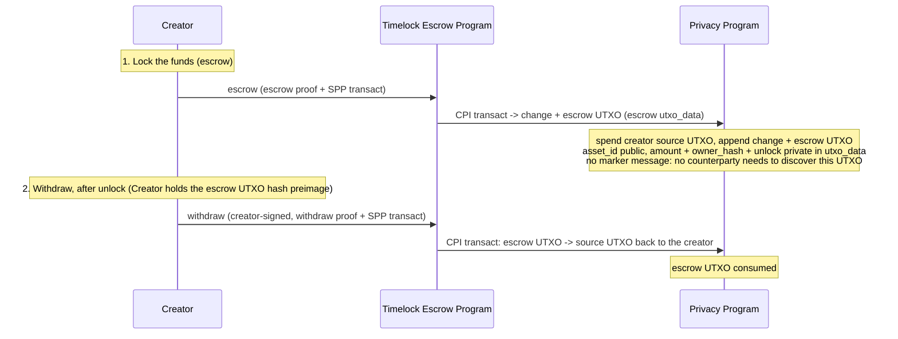

# Timelock Escrow Program

> [!WARNING]
> Example design, not audited. The implementations in this directory use
> insecure test keys and must not be deployed or used with real funds.

The timelock escrow program lets a creator lock funds as a shielded UTXO in the Solana Privacy
Program (SPP) with a chosen unlock timestamp, and reclaim them itself once that timestamp has
passed. The same creator that locks the funds is the only party that can withdraw them.

The timelock escrow program is an SPP ZK program: it verifies a small proof of its own escrow rules
and delegates the confidential transfer to SPP. It stores no state and owns no accounts.

This document specifies the escrow's privacy model, the escrow terms, the program's instructions,
and its circuits.

## Flow



## Table of Contents

- [Glossary](#glossary)
- [Privacy Model](#privacy-model)
- [Accounts](#accounts)
- [Escrow Terms](#escrow-terms)
- [Instructions](#instructions)
  - [escrow](#escrow)
  - [withdraw](#withdraw)
- [Circuits](#circuits)
  - [Escrow circuit](#escrow-circuit)
  - [Withdraw circuit](#withdraw-circuit)

## Glossary

Types used in this document. Shared SPP types are defined in [spec.md](../../docs/spec.md#glossary).

| Type | Encoding | Definition |
| --- | --- | --- |
| `Address` | `[u8; 32]` | Solana account address. |
| `asset_id` | `u64` | Asset identifier in UTXOs; `1` is SOL, each SPL mint `≥ 2`. The mint→`asset_id` map is the SPP `Asset registry` PDA. See [spec.md](../../docs/spec.md#glossary). |
| `CompressedShieldedAddress` | `[u8; 65]` | `(owner_hash [u8;32], viewing_pk tagged X25519[33])`. See [spec.md](../../docs/spec.md#shielded-address). |
| `escrow-authority PDA` | `Address` | The creator's program address, `find_program_address([b"escrow_authority", creator], program_id)`: one per creator. It owns the creator's escrow UTXOs, so a creator finds them by deriving it. |
| `escrow UTXO` | — | The SPP [UTXO](../../docs/spec.md#utxo) holding the locked funds: `asset = asset_id`, `amount = amount`, `owner = the creator's escrow-authority PDA`, nullifier secret `= 0`, `utxo_data = escrow terms`. The escrow proof enforces the owner, so the UTXO is spendable only by the timelock escrow program. See [Escrow Terms](#escrow-terms). |
| `Escrow terms` | — | The fields the escrow UTXO commits, hashed into its `utxo_hash` via `data_hash`: `owner_hash`, `unlock`. The `data_hash` form and where the terms are kept are implementation-defined. See [Escrow Terms](#escrow-terms). |
| `private_tx_hash` | `[u8; 32]` | Commitment to the SPP `transact` an escrow proof authorizes: the link between an escrow proof and the SPP transaction. See [spec.md](../../docs/spec.md#zk-program-interface). |
| `EscrowProof` / `WithdrawProof` | `[u8; 128]` | Groth16 proofs verified by the timelock escrow program, each committing the transaction via `private_tx_hash`. Both use standard Groth16. The creator authorizes with a Solana transaction signature. |
| `TransactIxData` | — | SPP `transact` instruction data: the SPP proof, input nullifiers, output UTXO hashes, ciphertexts, and routing. See [spec.md](../../docs/spec.md#transact). |
| `hash_bytes` | fn | `Poseidon` hash of a 32-byte value, reduced into the field the circuits check over. |
| `solana_owner_identity` | fn | The owner pk field of a Solana pubkey: `hash_bytes` of the key tagged as a Solana key. An owner hash is `Poseidon(owner_pk_field, nullifier_pk)`; the program computes it from a signer so the proof can compare it against a committed hash. |

## Privacy Model

What is public and what is private. The confidentiality is inherited from the SPP confidential
ring; the timelock escrow program does not try to hide which action ran.

- **Public:** which escrow instruction ran; `asset_id` at escrow and again at withdraw (`asset_id`s
  are SPP public inputs); the escrow UTXO hash at escrow; the escrow `unlock` timestamp, revealed at
  withdraw so the program can check it against the Clock; each transaction's SPP output UTXO hashes
  and ciphertexts; the creator's Solana signer pubkey and its escrow-authority PDA, at both
  escrow and withdraw, which the creator signs, so whose escrow it is is public.
- **Private:** `amount`, the locked value, and the aggregate volume per asset. These live only
  inside confidential UTXOs and the escrow UTXO `utxo_data`.
- **Unlinkable:** SPP hides the link between a created UTXO and its later spend, so when a creator
  has several escrows an observer cannot tell which of them a `withdraw` spent; it does see whose
  escrow it was.

## Accounts

The timelock escrow program owns no accounts: the locked funds live in the escrow UTXO, a leaf in
the SPP trees, moved by CPI. There is no rent-paying account to create or close, and no counterparty
compensation (unlike the swap program's taker spread) since the same creator both locks and later
reclaims the funds.

## Escrow Terms

The escrow UTXO holds the escrow terms and funds. `escrow` commits the escrow terms into the escrow
UTXO `utxo_hash` through `data_hash` (committed unchecked, interpreted by the escrow circuit — see
[spec.md](../../docs/spec.md#utxo)):

```text
escrow_terms = (
    owner_hash,   // the creator's shielded owner hash: receives change at escrow and the withdrawal at withdraw
    unlock,       // unix seconds; revealed at withdraw and checked against the Clock by the program
)
data_hash = commitment to escrow_terms    // enters the escrow UTXO utxo_hash directly
```

Each implementation fixes the `data_hash` form and where the terms are kept:

- gnark: `data_hash = Poseidon(owner_hash, unlock)`. The escrow UTXO has no `utxo_data`; the
  creator keeps the terms with the escrow UTXO opening.
- Xark: the terms are an SDK state (`UtxoState`) whose `creator` field is the creator's owner
  (`owner_pk_field`, `nullifier_pk`), the preimage of `owner_hash`. `data_hash` is the SDK state
  hash, `Poseidon(DATA, Poseidon(discriminator, owner_hash, unlock))`, where `DATA` is the SDK's
  data-UTXO domain and `discriminator` the first 8 bytes of `sha256("account:EscrowTerms")`.
  `utxo_data` contains the Borsh-encoded terms, encrypted with the output; the creator decrypts
  them to find its escrow and withdraw.

`asset_id`, `amount`, and `owner` are the escrow UTXO's own SPP fields, already committed in
`utxo_hash`. The escrow UTXO's owner is the creator's escrow-authority PDA (seeds
`[b"escrow_authority", creator]`) and its nullifier secret is hardcoded to 0, so:

```text
escrow_authority_pda   = find_program_address([b"escrow_authority", creator], program_id)
escrow_utxo_owner_hash = Poseidon(solana_owner_identity(escrow_authority_pda), Poseidon(0))   // one per creator
nullifier              = Poseidon(utxo_hash, blinding, 0)                                     // recomputed from the preimage
```

The escrow proof checks that the escrow output's owner equals this hash, which the program
computes from the `creator` signer (see the [escrow circuit](#escrow-circuit)). SPP alone accepts
any owner that signs the transact, including the creator, who signs for the source. The proof
check stops a creator from owning the escrow UTXO itself, or putting it under another creator's
PDA, and spending it before unlock without the program.

Knowledge of the escrow UTXO hash preimage, the escrow terms plus the escrow UTXO `blinding`, is
the complete spend capability: the nullifier includes the `blinding` and the circuits need it to
recompute the escrow UTXO `utxo_hash`. There is no marker message: unlike the swap program, there
is no counterparty that needs to learn of this UTXO's existence. The creator finds its escrow UTXOs
by deriving its escrow-authority PDA and fetching the transactions tagged with it, then decrypting
them with its own viewing key. Moving the escrow UTXO requires the program: SPP spends a PDA-owned
UTXO only when the timelock escrow program produces that PDA's signature via `invoke_signed`. The
program also signs at `escrow`, for the data-bearing escrow output, but there the proof pins the
only input to the creator signer's own UTXO, so it spends a PDA-owned UTXO only through `withdraw`
(after unlock, creator-signed, to `owner_hash`). The program derives
the PDA from the `creator` signer and the instruction's `authority_bump`, checks it is present
among the forwarded SPP accounts, and flips it to a signer inside the SPP CPI with seeds
`[b"escrow_authority", creator, authority_bump]`; the PDA is a bare address and signs only inside
the CPI.

The PDA's bump travels in the instruction data as `authority_bump: u8`. The program derives the
PDA with one `create_program_address([b"escrow_authority", creator, [authority_bump]],
program_id)` and fails with `InvalidEscrowAuthorityBump` (9006) when that is not a program
address. Clients pass the canonical bump from `find_program_address`, so the program's cost does
not depend on how many bumps the search tries. A non-canonical bump that still derives a program
address names another PDA of the same creator: an escrow with it puts the escrow UTXO under that
PDA, and a withdraw with it spends only UTXOs that PDA owns. It does not reach another creator's
UTXOs.

`owner_hash` is the committed destination for both the change output at `escrow` and the refund at
`withdraw`: the creator recovers both from the escrow UTXO blinding it already holds.

In both implementations the source UTXO is the creator's own, and the change returns to the
creator. The creator signs the SPP transact as the source's owner signer, ahead of its
escrow-authority PDA, which signs only because SPP requires the owner of the data-bearing escrow
output to sign. The escrow proof checks the source owner against the `creator` signer: in Xark the source
owner's `owner_pk_field` must equal `solana_owner_identity` of the signer, and `owner_hash` is the
source owner's hash; in gnark the source UTXO is a private witness whose owner must equal
`owner_hash`, and `owner_hash` must be `Poseidon(owner_pk_field, nullifier_pk)` with the public
`owner_pk_field`. So no UTXO owned by the creator's escrow-authority PDA can fund an escrow,
including the creator's own escrow UTXO, whose preimage the creator knows and which the program
signs for; and the creator who withdraws derives the same PDA. `withdraw` requires the creator: it
signs the withdraw transaction, the program signs only for that creator's PDA, and the withdraw
proof checks the signer's `owner_pk_field` against the escrow's `owner_hash`. The refund can only
land at `owner_hash`.

`unlock` is a unix-seconds value the proof reveals as a public input and the timelock escrow
program checks against the Clock sysvar: `withdraw` requires `now > unlock`. `escrow` does not
check `unlock` against the Clock — an escrow created with an already-past unlock timestamp
only harms the creator. The proof's public `unlock` must equal the committed escrow term, so the
withdrawer cannot shift the window.

## Instructions

| # | Instruction | Tag | Description | Accounts Read | Accounts Modified | Access control |
|---|-------------|-----|-------------|---------------|-------------------|----------------|
| 1 | [escrow](#escrow) | 0 | Verify the escrow proof and CPI SPP `transact` to lock the source funds into the escrow UTXO, owned by the creator's escrow-authority PDA. | escrow_authority | SPP trees (CPI) | Creator signs; the proof checks the escrow UTXO owner against the PDA the program derives from the creator |
| 2 | [withdraw](#withdraw) | 1 | Verify the withdraw proof and CPI SPP `transact`: after unlock, spend the escrow UTXO back to `owner_hash`. | escrow_authority | SPP trees (CPI) | Creator signs; the proof checks the signer against the committed `owner_hash`; the creator's escrow-authority PDA authorizes the escrow UTXO spend |

---

### escrow

Locks funds. The timelock escrow program verifies the [escrow proof](#escrow-circuit), then CPIs
SPP [`transact`](../../docs/spec.md#transact) to spend the creator's `asset_id` UTXO and append the
escrow UTXO, a UTXO of `amount` `asset_id` owned by the creator's escrow-authority PDA (seeds
`[b"escrow_authority", creator]`), with the [escrow terms](#escrow-terms) in its `utxo_data`. The
transact is 1-in/2-out (the creator's source UTXO in; a change UTXO to the creator and the escrow
UTXO out).

The proof checks the escrow UTXO output against the escrow rules (see the [escrow
circuit](#escrow-circuit)) without revealing the terms, and commits the transaction via
`private_tx_hash`. The program derives the creator's escrow-authority PDA from the `creator`
signer, computes the escrow owner the proof must match, and signs the SPP CPI as that PDA. The
amount and `unlock` are private at the escrow layer (the transact's own `asset_id` public inputs
still reveal `asset_id` at the SPP layer).

**Accounts**

1. `creator` — the creator's Solana signer; read-only, signer. Owns and spends the source UTXO.
   Consumed by the program, which derives the escrow-authority PDA and
   `solana_owner_identity(creator)` from it; everything after it is forwarded verbatim to the SPP
   `transact` CPI.
2. The SPP `transact` accounts, in SPP's order: the fixed `[payer, output_tree, spp_program,
   system_program]` prefix, where `payer` is the fee payer (signer, writable; any key, which may be
   the `creator`), the input-tree and nullifier runs, then the ordered owner signers: the
   `creator` again, as the source's owner signer, and last the creator's `escrow_authority` PDA,
   read-only and non-signer, which the program flips to a signer inside the CPI.

**Instruction data**

```rust
struct EscrowIxData {
    /// The escrow proof; verified by the timelock escrow program.
    proof: EscrowProof,
    /// Xark only: the viewing pubkey of the escrow UTXO's owner address, which with the
    /// PDA's owner hash forms the escrow-owner public input. It controls who can decrypt the
    /// escrow UTXO, not who can spend it.
    viewing_pubkey: [u8; 33],
    /// The bump of the creator's escrow-authority PDA; see [Escrow Terms](#escrow-terms).
    authority_bump: u8,
    /// SPP transact (1-in/2-out): creator source UTXO -> change + escrow UTXO, forwarded to SPP
    /// unchanged.
    transact: TransactIxData,
}
```

---

### withdraw

After unlock, the escrow UTXO is reclaimed to the committed `owner_hash`. The timelock escrow
program verifies the [withdraw proof](#withdraw-circuit), then CPIs SPP
[`transact`](../../docs/spec.md#transact). The transact is 1-in/1-out: the escrow UTXO in, an
`amount` `asset_id` UTXO to `owner_hash` out, proved at the SPP `(1, 2)` shape with compact padding
in the second output slot, which the instruction data leaves out. The creator signs as a dedicated readonly signer; the
program includes `solana_owner_identity` of its pubkey in the proof's public input and the circuit checks it
against the committed `owner_hash`, so only the creator can withdraw, and the creator knows the
refund blinding it chose. The timelock escrow program supplies the escrow-authority PDA signer via
`invoke_signed` and reads the escrow `unlock` from the dedicated `unlock_timestamp` instruction-data
field and checks it against the Clock sysvar (`now > unlock`); the withdraw proof takes that same
value as a public input.

**Accounts**

1. `caller` — fee payer; signer, writable. Consumed by the program. `now` is read from the Clock
   sysvar via syscall.
2. `creator` — the creator's Solana signer; read-only, signer. Consumed by the program, which
   includes `solana_owner_identity(creator)` in the withdraw proof's public input; everything after it is
   forwarded verbatim to the SPP `transact` CPI.
3. The SPP `transact` accounts, in SPP's order: the fixed `[payer, output_tree, spp_program,
   system_program]` prefix, the input-tree and nullifier runs, then the owner signer: the
   creator's `escrow_authority` PDA (seeds `[b"escrow_authority", creator]`), read-only and
   non-signer. The program derives it from the `creator` signer and flips it to a signer inside
   the SPP CPI to authorize the escrow UTXO spend (see [Escrow Terms](#escrow-terms)).

**Instruction data**

```rust
struct WithdrawIxData {
    /// The withdraw proof; verified by the timelock escrow program.
    proof: WithdrawProof,
    /// The committed escrow unlock timestamp, checked against the Clock (now > unlock) and a
    /// proof public input.
    unlock_timestamp: u64,
    /// The bump of the creator's escrow-authority PDA; see [Escrow Terms](#escrow-terms).
    authority_bump: u8,
    /// SPP transact (1-in/1-out): escrow UTXO -> source UTXO to owner_hash.
    transact: TransactIxData,
}
```

## Circuits

The timelock escrow program runs two circuits, each with its own verifying key, distinct from the
SPP value proof inside `transact`. Each circuit takes the SPP transaction's UTXO hash preimages as
private inputs (the escrow UTXO input or output, the change/source output), enforces the escrow
rules below, and commits the transaction via `private_tx_hash`: each proof has a single public
input, which commits `private_tx_hash` with the circuit's public values; how that input is
encoded is up to the implementation. SPP proves
the UTXOs are in the tree and conserves value; the escrow circuits rely on that rather than proving
membership themselves. Both circuits use standard Groth16 without lookup commitments. Concrete shape
parameters (input/output slot counts) are fixed once and benchmarked, and must match the SPP
`transact` shapes the instructions use. The circuits are small and proven in-process by the
client (each implementation's README says how); the SPP transfer proof still comes from the
existing SPP prover.

### Escrow circuit

Proves the escrow UTXO output commits the escrow terms. Matches the 1-in/2-out transact (source
UTXO in; change + escrow UTXO out), padded to an SPP proving shape that fits it (each
implementation's `BENCHMARK.md` names the shape).

- **Public inputs:** `private_tx_hash` from `TransactIxData`; `owner_pk_field`,
  `solana_owner_identity` of the `creator` signer's pubkey; and the escrow owner, which the program
  computes from the creator's escrow-authority PDA. How they encode into the proof's public input
  is implementation-defined:
  - gnark: one public input, `Poseidon(private_tx_hash, escrow_owner_hash, owner_pk_field)`, where
    `escrow_owner_hash` is the PDA's owner hash.
  - Xark: the SDK's public-input hash over `owner_pk_field` and `escrow_owner`, the PDA's owner
    address `Poseidon(escrow_owner_hash, hash_bytes(viewing_pubkey))` with the `viewing_pubkey`
    from the instruction data.
- **Private inputs:** the escrow terms (`owner_hash`, `unlock`), the source UTXO, and the escrow
  UTXO and change output UTXO hash preimages.
- **Constraints:**
  - The `private_tx_hash` recomputation mirrors the padded transact exactly: the input hash chain
    covers `[source_input, 0]`, the output hash chain covers `[change, escrow_utxo]`, and the
    address hash chain is the zero chain, each folding only its nonzero entries (see
    [private_tx_hash](../../docs/spec.md#spp-proof---solana-privacy-zk-proof)).
    A zero-amount change output is still a real UTXO whose hash enters the output chain.
  - The source input is the creator's: its owner is `owner_hash` (gnark), or its owner's
    `owner_pk_field` is the public `owner_pk_field` (Xark). It is a default-ring UTXO with empty
    data holding the escrow UTXO's asset. SPP additionally requires the source owner to sign.
  - The escrow UTXO output committed in `private_tx_hash` has the `data_hash` of the escrow terms
    (see [Escrow Terms](#escrow-terms)),
    `ring_program_id = 0` and `ring_data_hash = 0` (the [default, non-ring](../../docs/spec.md#default-ring)
    UTXO variant), and a nonzero amount, so the public SPP escrow UTXO output commits the terms.
  - The escrow UTXO output's owner is the public escrow owner, the creator's escrow-authority PDA,
    so only the program can spend it, and only for that creator.
  - `owner_hash` belongs to the creator signer: in Xark it is the source owner's, and the source
    owner's `owner_pk_field` must equal the public `owner_pk_field`; in gnark
    `Poseidon(owner_pk_field, nullifier_pk) == owner_hash` with the public `owner_pk_field`.
  - The change output is constrained to the escrow UTXO's asset and to `owner_hash`, with empty
    data.

### Withdraw circuit

Reclaims the escrow UTXO to the committed `owner_hash` after unlock. Matches the 1-in/1-out
transact (escrow UTXO in; source-to-owner out), proved at the SPP `(1, 2)` shape with a compact
padding second output that the private transaction hash does not see. The program enforces `now > unlock` against the
Clock; the circuit only reveals `unlock` and checks it equals the committed term.

- **Public inputs:** one Poseidon hash of `private_tx_hash`, `unlock` and `owner_pk_field` (the
  input order is up to the implementation), where `owner_pk_field` is `solana_owner_identity` of the
  creator signer's pubkey, fed by the program.
- **Private inputs:** the escrow UTXO hash preimage (incl. `utxo_data` = escrow terms, `amount`,
  `escrow_utxo_blinding`), the `source_output` hash preimage, and the creator's `(owner_pk_field,
  nullifier_pk)`, the preimage of the committed `owner_hash`. The circuit leaves the escrow UTXO
  owner a free witness: SPP spends it only with the PDA signature, which the program produces only
  for the `creator` signer's PDA.
- **Constraints:**
  - The public `unlock` equals the committed escrow `unlock`.
  - `Poseidon(owner_pk_field, nullifier_pk)` equals the committed `owner_hash`, so the proof
    verifies only with the creator signer the program supplies.
  - The output committed in `private_tx_hash` is `source_output == (asset_id, amount,
    owner_hash)`.
